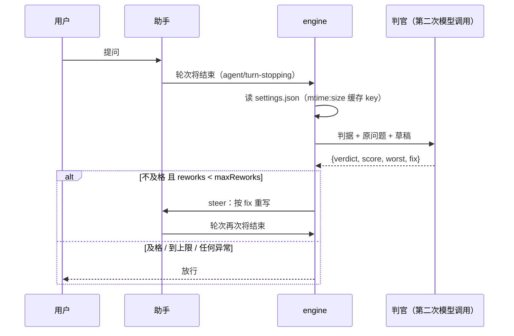

# dsh-quality-guard

**发消息之前，先让另一个模型读一遍。**

助手的回复在真正发给你之前，会被第二个模型当裁判判一次；不合判据就打回重写。
这是 DeepSeek Harness（dsh）的一个插件组合：`engine/`（钩子本体）+ `panel/`（可视化面板，可选）。

> 一句话版本：机械判据（字数、正则、格式）管不住的偏题、铺垫、术语堆砌，只能靠**语义判定**。

---

## 为什么要第二个模型

第一版用的是机械判据：字数 ≤800、出现数值必须有锚点。结果很难看——一段完全答非所问的回复，只要够短、带个链接，就合规了。

真正的需求是「用最直白的话，把最核心的那个因素放在最前面」，这条没有正则能表达：它要读语义，还要对照原问题看有没有答偏。

所以判据交给第二个模型。依据是：**同一条上下文里的自检基本无效**（Huang et al., *Large Language Models Cannot Self-Correct Reasoning Yet*, arXiv:2310.01798），而独立轮次的验证才真的有效（CoVe, arXiv:2309.11495）。代价是每轮多一次模型调用——如果你觉得认知带宽比 token 贵，这笔买卖就划算。

---

## 两半分别是什么

| 目录 | 角色 | 干什么 |
| --- | --- | --- |
| `engine/` | selfcheck-guard | 挂在 `agent/turn-stopping` 上。轮次要结束时往 next-step 投一条消息，轮次就不结束，模型接着改；判官是另起的一次模型调用。 |
| `panel/` | dsh-quality-guard | Web 面板：侧边栏一行「质检」+ 主栏一页编辑器。读写 `~/.dsh/quality-guard/settings.json`。 |

**「面板改完即时生效」不靠热重载**：引擎在每次判决前重新 `stat` + 读一遍 `settings.json`（用 `mtime:size` 做缓存 key），文件一变，下一轮就用新值。

---

## 一次检查是怎么走的



判官拿不到 llm、超时、报错、没有路由——全部走右边的放行分支（fail-open）。

## 安装

### 1. 引擎（必须）

```bash
# 把 engine/ 整个拷到插件目录
~/.dsh/plugins/selfcheck-guard/
```

然后在你的 `~/.dsh/profiles/<profile>/cordis.patch.yml` 末尾追加一段 `insert`，把路径换成你自己的绝对路径（Windows 用正斜杠）：

```yaml
- insert:
    - id: selfcheck-guard
      name: 'C:/Users/YOUR_NAME/.dsh/plugins/selfcheck-guard/index.mjs'
      config:
        settingsFile: 'C:/Users/YOUR_NAME/.dsh/quality-guard/settings.json'
        criteriaFile: 'C:/Users/YOUR_NAME/.dsh/plugins/selfcheck-guard/criteria.example.md'
        auditFile: 'C:/Users/YOUR_NAME/.dsh/quality-guard/audit.jsonl'
        dryRun: true          # 先演习，只记日志不打回
        maxReworks: 3
        timeoutMs: 20000
        maxTokens: 1500
```

完整示例见 [`examples/cordis.patch.example.yml`](examples/cordis.patch.example.yml)。改完重启 dsh（或重载 patch）。

`settings.json` 不存在也没关系：引擎会用 patch 里的静态配置 + `criteriaFile` 开跑。

### 2. 面板（可选）

```bash
# 拷到插件目录
~/.dsh/plugins/dsh-quality-guard/

# 在 profile 的 node_modules 里建目录联接（Windows）
cmd /c mklink /J "%USERPROFILE%\.dsh\profiles\<profile>\node_modules\dsh-quality-guard" "%USERPROFILE%\.dsh\plugins\dsh-quality-guard"
```

patch 里再追加一条按**包名**挂的：

```yaml
- insert:
    - id: quality-guard
      name: dsh-quality-guard
```

面板需要 `react ^18.2` 和 `@deepseek-ai/dsh-client-locale`、`@deepseek-ai/dsh-client-ui-layout`（后两个 dsh 自带）。重启后侧边栏出现「质检」。

---

## 配置

两个来源，**活设置优先**：

1. `settingsFile`（`~/.dsh/quality-guard/settings.json`）——面板写的就是它，人也能手改；引擎每轮现读。
2. patch 里的静态 `config`——只在 ①读不到/读不懂时兜底（fail-open）。

| 字段 | 含义 | 范围 | patch 默认 | 面板默认 |
| --- | --- | --- | --- | --- |
| `enabled` | 总闸，关掉＝一条都不查 | bool | `true` | `true` |
| `dryRun` | 演习：只判断、只记日志、不打回 | bool | `true` | `true` |
| `triggers.minReplyChars` | 回复短于这个字数就跳过检查 | 0–20000 | `0` | `0` |
| `triggers.maxReworks` | 同一轮最多打回几次，防死循环 | 0–10 | `3` | `3` |
| `triggers.scoreThreshold` | 判官打分的及格线 | 0–100 | `70` | `70` |
| `judge.timeoutMs` | 判官超时就放弃，本条放行 | 1000–120000 | `20000` | `20000` |
| `judge.maxTokens` | 判官最多能输出多少 token | 64–8000 | `1500` | `1500` |
| `judge.model` | 指定判官模型 `{provider, model}`；留空＝沿用当前会话的路由 | — | `null` | `null` |
| `auditFile` | 审计日志落点；**空字符串＝不写** | — | — | `~/.dsh/quality-guard/audit.jsonl` |
| `settingsFile` | 活设置文件落点 | — | — | — |
| `criteriaFile` | 判据文本文件；仅在活设置里没有 `criteria` 数组时启用 | — | — | — |

超出范围的数值会被夹回默认值（引擎侧 `index.mjs` 的 `readLive()`），面板侧则直接报人话错误。

### 判据怎么写

两种写法，二选一：

- **文本文件**（`criteriaFile`）：内容**原样**喂给判官，不解析。示例见 [`engine/criteria.example.md`](engine/criteria.example.md)。
- **面板**（`settings.json` 的 `criteria` 数组）：每条 `{id, label, enabled, text}`，勾掉的跳过；`exceptions` 是一个文本框，一行一条，拼正文时自动加 `- ` 前缀。

两者最终拼成同一段文本：

```
判据（任一条不满足即不合格）：
1. ……
2. ……

例外：
- ……
```

全部勾掉或全空 → 退回代码内置判据（宁可判得严，也不要静悄悄变成不查）。

---

## 已知行为（别当 bug）

**打回时界面上会多留一条旧回复。** 打回走 `agent.steer()`，而旧回复在这之前已经按 `surfaceOp: "append"` 落盘了，界面只收 append——改不了。设计取舍：你能同时对照看「长版」和「短版」。真要只保留最后一版，得改挂 `llm/stream`、攒完整条再判，那会牺牲流式体感。

**一切失败都放行（fail-open）。** 判官超时、报错、拿不到 llm 服务、没有模型路由、`settings.json` 读坏——全部跳过检查继续会话。质检绝不该把会话卡住。

**判官 `maxTokens` 别调回 800。** 判官要输出 JSON，800 会被截断，表现为日志里 `judge returned no JSON`，然后整条 fail-open 放行——看起来「没报错」，实际是压根没判。默认已提到 1500。

**同一 turn 最多打回 `maxReworks` 次**，计数在内存里按 `session:turn` 分桶，进程重启清零。

---

## 隐私红线

`~/.dsh/quality-guard/audit.jsonl` 每一行都是**你真实对话的复述**：

```json
{"at":"…","turn":12,"session":"…","score":45,"failed":true,
 "worst":"只说『继续』，回复却甩出完整问题复盘…","fix":"先给结论，删掉没问的旁支…",
 "rework":0,"dryRun":false,"route":"…/…","chars":1180}
```

`worst` / `fix` 是判官写的原话，等于把你的对话摘要留在了磁盘上。所以：

- `.gitignore` 已挡掉 `*.jsonl`、`settings.json` 和一切备份——**别强行 `git add -f`**。
- 分享截图前，先看面板里的判据有没有混进私人设定（人设、口癖、内部项目名）。
- 想不留痕：`auditFile` 留空即可，质检照常工作。

---

## 自测

```bash
node engine/selftest.mjs
# → 30 passed, 0 failed
```

用假 llm，不联网、不花钱，覆盖：判据拼装、超时/报错放行、`maxReworks` 上限、`dryRun`、外部判据文件、活动设置覆盖 patch 等。

---

## 环境

- 实测：DeepSeek Harness 桌面版 `0.2.1-rc.5`，Windows，Node `24.21.0`。
- 只用了 Node 内置模块，引擎零依赖；面板依赖 `react ^18.2`。
- macOS / Linux 路径分支未实测。

---

## 更新日志

见 [CHANGELOG.md](CHANGELOG.md)。

---

## License

MIT —— 见 [LICENSE](LICENSE)。

---

<details>
<summary>English</summary>

A pre-send quality gate for DeepSeek Harness: before an assistant reply reaches the user, a **second model** judges it against your written criteria and the reply is sent back for a rewrite if it fails. Mechanical rules (length, regex) cannot catch off-topic padding or jargon walls — semantic judgement can. `engine/` is the hook, `panel/` is an optional web UI. Everything fails open, so the gate can never wedge a session. MIT.

</details>
