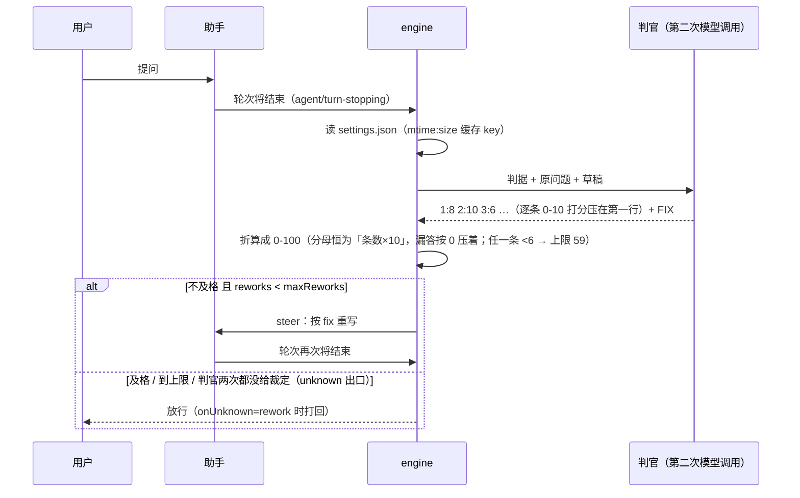

# dsh-quality-guard

**发消息之前，先让另一个模型读一遍。**

助手的回复在真正发给你之前，会被第二个模型当裁判判一次；不合判据就打回重写。
这是 DeepSeek Harness（dsh）的一个插件组合：`engine/`（钩子本体）+ `panel/`（可视化面板，可选）。

> 一句话版本：机械判据（字数、正则、格式）管不住的偏题、铺垫、术语堆砌，只能靠**语义判定**。

---

## 为什么要第二个模型

第一版用的是机械判据：字数 ≤800、出现数值必须有锚点。结果很难看——一段完全答非所问的回复，只要够短、带个链接，就合规了。

真正的需求是「用最直白的话，把最核心的那个因素放在最前面」，这条没有正则能表达：它要读语义，还要对照原问题看有没有答偏。

所以判据交给第二个模型。依据是：**同一条上下文里的自检基本无效**（Huang et al., *Large Language Models Cannot Self-Correct Reasoning Yet*, arXiv:2310.01798），而独立轮次的验证才真的有效（CoVe, arXiv:2309.11495）。代价是每轮多一次模型调用——如果你觉得认知带宽比 token 贵，这笔买卖就划算。

---

## 两半分别是什么

| 目录 | 角色 | 干什么 |
| --- | --- | --- |
| `engine/` | selfcheck-guard | 挂在 `agent/turn-stopping` 上。轮次要结束时往 next-step 投一条消息，轮次就不结束，模型接着改；判官是另起的一次模型调用。 |
| `panel/` | dsh-quality-guard | Web 面板：侧边栏一行「质检」+ 主栏一页编辑器。读写 `~/.dsh/quality-guard/settings.json`。 |

**「面板改完即时生效」不靠热重载**：引擎在每次判决前重新 `stat` + 读一遍 `settings.json`（用 `mtime:size` 做缓存 key），文件一变，下一轮就用新值。

---

## 判官提示词也能改（v1.7.0）

判据（「按什么查」）早就能在面板里随便改，v1.7.0 起**给判官的提示词**也一样：面板「判官提示词」一节里两个框，保存写进同一个 `settings.json`，引擎每轮现读，**改完下一轮就生效，不用重启**（前提是引擎已是 v1.7.0，见下）。

| 字段 | 管什么 |
| --- | --- |
| `judgeSystem` | 判官的 system 消息：它是谁、只管什么、什么算违规、什么算满足 |
| `judgeRules` | 逐条打分的规则 + 0/2/4/6/8/10 六档量表：「客观加不了打 10」「任一条低于 6 分直接不合格」都在这里 |

**框里、settings.json 里、判官实际用的，是同一份全文**——没有「留空＝默认」这回事。两个框都不能留空；想恢复出厂默认，点面板右上角的「恢复默认」，它会把默认全文重新写回 `settings.json`。

**输出格式骨架写死不给改**：`编号:分数` 第一行、第二行 `FIX:` 这段留在 `engine/index.mjs` 的 `scoreItemsPrompt` 里。因为 `parseScores` 靠这个格式解析，放开让人改坏会整轮判不出来。

想收紧给分，直接改 `judgeRules`：把「8 分：基本做到」写成「8 分：只有极小的措辞瑕疵，且必须能逐条指出哪里做到了」，或把「客观加不了打 **10**」改成「打 **8**」；想连人设/打分口径一起换，改 `judgeSystem`。两个字上限各 20000（面板 `normalize()` 校验）。改完保存，下一轮判官就用新全文。

> 注意：**引擎本体换了代码，这次得重启一次 DSH**（引擎同路径改不重载，disable/enable 无效）。重启之后，改提示词就再也不用重启了；面板前端刷新一下页面（F5）就能看见新框。

## 一次检查是怎么走的



判官拿不到 llm、超时、报错、没有路由——仍然走放行分支（fail-open）。但**判官已经吐出来的分数不会被丢掉**：断流、`max-tokens`、半截 JSON 都先抢救分数，拿不到分数才补判一次，两次都空才进 unknown 出口。

v1.4.0 起判官走**逐条 0-10 打分**：判据里只要有 ≥2 条编号条目，每条判据各拿一个 0-10 的分，总分由程序换算。为什么不是 yes/no、也不是让判官直接给 0-100，见[为什么不逐条 yes/no，也不直接打分](#为什么不逐条-yesno也不直接打分)。

**任一条判据低于 6 分就不合格**（v1.5.0 起）：低于 6 分的条目把满分折算到 59（必然低于任何 ≥60 的及格线），并且判定直接记 fail——两道保险，就算有人把及格线调到 50 以下也放不出去。v1.4.0 起初只让第 1 条当硬门槛，理由是「保持某某人设」这类风格项在普通回复上永远拿不到满分；但 v1.4.0 的「客观加不了打 10」已经治好了那个病，留下的低分都是真没做到。用户 2026-11-03 拍板：「你现在这个给分太宽泛了，谁都可以踢一脚，怎么行」——五条判据得条条能一票否决，否则等于五条建议。注意 6 分本身不触发否决（6 分＝做到一半），只有 0/2/4 才折算。

## 安装

**一条命令，面板和引擎一起装上：**

```bash
dsh plugin --profile web add https://github.com/wdj20050927/dsh-quality-guard/releases/download/v1.7.2/dsh-quality-guard-1.7.2.tgz
```

把 `web` 换成你实际用的 profile 名（桌面版一般是 `desktop`）。装完重启 dsh，侧边栏出现「质检」，引擎也已经在跑——`package.json` 里的 `dsh.bundle.patch` 指向 `panel/cordis.patch.yml`，那个文件一次 `insert` 了两条：面板（`quality-guard`）和引擎（`selfcheck-guard`，`name: ../engine/index.mjs`，相对 patch 文件所在目录解析）。

想确认真的插进去了：

```bash
dsh --profile web --dump-config
```

输出里应当出现两段：

```
# == dsh-quality-guard
- id: quality-guard
  name: dsh-quality-guard
...
- id: selfcheck-guard
  name: >-
    file:///.../node_modules/dsh-quality-guard/engine/index.mjs
```

### 为什么不用 npm 包名装

npm 上还没有这个包（`https://registry.npmjs.org/dsh-quality-guard` → 404）。上面那条是 GitHub Release 里预构建好的 tarball，`dsh plugin add` 认 `.tgz` 直链（`@deepseek-ai/dsh-plugin-manager` 的 `TARBALL_SPEC`），装出来的和 npm 包一模一样。

`github:wdj20050927/dsh-quality-guard` 这种 git 装法也能装出面板，但不推荐：pnpm 从 git 装不跑 `prepack`，版本号会读成 `0.0.0`，而且上一次失败留下的目录联接会让重跑报 `ERR_PNPM_EPERM`。

### 默认是演习模式

装完 `dryRun: true`——只判断、只记日志（`~/.dsh/quality-guard/audit.jsonl`）、**不打回**。先看几天日志，确认判官判得对，再去面板把「演习模式」关掉。这是故意的：刚装上就真打回，你会被一条判据不合口味反复回炉。

### 装在哪、怎么卸载

插件进的是 `<profile>/node_modules/`，`dsh plugin --profile <name> remove dsh-quality-guard` 卸掉。验证用的临时 profile 直接删目录即可。

---

## 手动装（本机开发调试用）

如果你在改这个仓库本身，需要让 dsh 直接用工作区里的实体文件：

```bash
dsh plugin --profile <profile> add D:\path\to\dsh-quality-guard
```

这会在 profile 的 `node_modules` 里建一个目录联接（Windows 上是 Junction），改代码立刻反映到下一次启动。

手工挂载（dsh 版本不支持 `dsh.bundle` 时）：

```yaml
# ~/.dsh/profiles/<profile>/cordis.patch.yml
- insert:
    - id: quality-guard
      name: dsh-quality-guard

- insert:
    - id: selfcheck-guard
      name: 'C:/Users/YOUR_NAME/.dsh/plugins/selfcheck-guard/index.mjs'
      config:
        settingsFile: 'C:/Users/YOUR_NAME/.dsh/quality-guard/settings.json'
        criteriaFile: 'C:/Users/YOUR_NAME/.dsh/plugins/selfcheck-guard/criteria.example.md'
        auditFile: 'C:/Users/YOUR_NAME/.dsh/quality-guard/audit.jsonl'
        dryRun: true
        maxReworks: 3
        timeoutMs: 60000
        # 输出预算由引擎按档位自动算，别填 maxTokens（填数字＝关掉自动预算）
```

完整示例见 [`examples/cordis.patch.example.yml`](examples/cordis.patch.example.yml)。

`settings.json` 不存在也没关系：首次加载面板会写一份默认值，引擎也会退到 patch 里的静态配置 + `criteriaFile`。

**两个已知坑**（都是实测踩出来的）：

1. **同一份 `package.json` 名字不能给两半共用。** 面板声明了 `dsh.client`，引擎是路径挂载；`@deepseek-ai/dsh-client-modules` 的 `reconcilePackage()` 按包名去重，两半同包名会报 `resolves from multiple active Loader sources` 并让 `dsh-client-modules` 这个 required 插件启不来。所以 `engine/package.json` 单独叫 `dsh-quality-guard-engine`——它是 `nearestPackage()` 向上找 package.json 的停止点。
2. **`package.json` 不能带 BOM。** 用 PowerShell `Set-Content -Encoding utf8` 手写会加 `EF BB BF`，dsh 报 `SyntaxError: Unexpected token ''` 并整个跳过这个 bundle。

---

## 配置

两个来源，**活设置优先**：

1. `settingsFile`（`~/.dsh/quality-guard/settings.json`）——面板写的就是它，人也能手改；引擎每轮现读。
2. patch 里的静态 `config`——只在 ①读不到/读不懂时兜底（fail-open）。

| 字段 | 含义 | 范围 | patch 默认 | 面板默认 |
| --- | --- | --- | --- | --- |
| `enabled` | 总闸，关掉＝一条都不查 | bool | `true` | `true` |
| `dryRun` | 演习：只判断、只记日志、不打回 | bool | `true` | `true` |
| `triggers.minReplyChars` | 回复短于这个字数就跳过检查 | 0–20000 | `0` | `0` |
| `triggers.maxReworks` | 同一轮最多打回几次，防死循环 | 0–10 | `3` | `3` |
| `triggers.scoreThreshold` | 判官打分的及格线（任一条 <6 分另外直接打回，不受它影响） | 0–100 | `70` | `80` |
| `judge.timeoutMs` | 判官超时就放弃，本条放行 | 1000–120000 | `60000` | `60000` |
| `judge.model` | 指定判官模型 `{provider, model}`；留空＝沿用当前会话的路由 | — | `null` | `null` |
| `reasoningEffort` | 判官思考多深、最多能输出多少 token——**这两项由插件自己定**（v1.3.0）：先用最省的那档，判不出来才升级；预算随档位一起涨 | `auto` | `auto` | `auto` |
| `onUnknown` | 判官两次都拿不到裁定（超时/断流/空输出）时：`pass` 放行，`rework` 打回重写 | `pass` \| `rework` | `rework` | `rework` |
| `auditFile` | 审计日志落点；**空字符串＝不写** | — | — | `~/.dsh/quality-guard/audit.jsonl` |
| `settingsFile` | 活设置文件落点 | — | — | — |
| `criteriaFile` | 判据文本文件；仅在活设置里没有 `criteria` 数组时启用 | — | — | — |

超出范围的数值会被夹回默认值（引擎侧 `index.mjs` 的 `readLive()`），面板侧则直接报人话错误。

**判官的档位和输出预算不用你填（v1.3.0）。** 面板上这两项已经撤掉，只剩一行说明：引擎先用最省的那档（`low`；`off` 会被上游 11133 拒，不可用），判不出来才升一档重判；预算（`maxTokens`）随档位一起涨，保证答案不会被推理挤没。手写 `settings.json` 里塞旧值（`low` / `high` / `judge.maxTokens`）还能跑，但面板一保存就归一成 `auto`——这是故意的：手填的档位和预算正是「答案被推理挤没」的来源，不该再当可调项。

### 判据怎么写

两种写法，二选一：

- **文本文件**（`criteriaFile`）：内容**原样**喂给判官，不解析。示例见 [`engine/criteria.example.md`](engine/criteria.example.md)。
- **面板**（`settings.json` 的 `criteria` 数组）：每条 `{id, label, enabled, text}`，勾掉的跳过；`exceptions` 是一个文本框，一行一条，拼正文时自动加 `- ` 前缀。

两者最终拼成同一段文本：

```
判据（任一条不满足即不合格）：
1. ……
2. ……

例外：
- ……
```

全部勾掉或全空 → 退回代码内置判据（宁可判得严，也不要静悄悄变成不查）。

---

## 已知行为（别当 bug）

**打回时界面上会多留一条旧回复。** 打回走 `agent.steer()`，而旧回复在这之前已经按 `surfaceOp: "append"` 落盘了，界面只收 append——改不了。设计取舍：你能同时对照看「长版」和「短版」。真要只保留最后一版，得改挂 `llm/stream`、攒完整条再判，那会牺牲流式体感。

**一切失败都放行（fail-open），但「失败」的定义收窄了（v1.1.0）。** 判官超时、报错、拿不到 llm 服务、没有模型路由、`settings.json` 读坏——仍然跳过检查继续会话。质检绝不该把会话卡住。但**判官已经吐出来的分数不再被当成失败丢掉**：断流、`max-tokens`、半截 JSON，只要分数写出来了就按分数判；拿不到分数还会换一个更便宜的提示补判一次；两次都没有才走 unknown 出口（审计记 `decision: "unknown"`，`onUnknown=rework` 时打回重写）。

**判官输出预算别调回 800（v1.3.0 起自动，不用再管这一项）。** 判官输出的是判定行 + `FIX:`，800 会被截断（v1.1.0 起判定压在第一行，截断只吃掉尾巴，所以不再是致命的，但理由会缺）。这是 v1.3.0 之前手填时代的坑：那时默认 4000；现在预算随思考档位自动涨，面板也不再给这个输入框。

**判官偏严不一定是判官错了。** 实测踩过一次：拿「早上七点，在小区门口集合」当「好回复」，判官却按第 3 条（不旁生枝节）和第 4 条（数值必带出处）判了 no——它没判错，是那段回复本身多给了地点、还带了没有出处的数值。**测判官之前先确认语料本身无歧义。**

**「宁可判不合格」这句会自己加戏。** 判官系统提示原先写的是「宁可判不合格，也不要放过铺垫」。实测同一批语料：苛刻版好回复 80/80/100，中性版 100/100/80，而两类坏回复在两版下完全一样（47/47/47、35/35/35）。**严格度没换来区分度，只换来了误伤**，所以 v1.2.0 改成「判 no 必须指得出具体哪句话」。

**「一个字都没吐」现在查得出来了（v1.0.1）。** 引擎原先只收 `text-delta`，也只把 `finish.kind === 'error'` 当错；可超时 abort 在 SDK 里报的是 `aborted`，token 被推理吃光报的是 `max-tokens`——两种都静悄悄走到「空文本 → 放行」。现在：`aborted` 当显式超时、文本为空时从 `reasoning-delta` 里再捞一次 JSON、审计补上 `finish` / `judgeMs` / `textChars` / `reasonChars` / `textSource`。兜底默认同步提到 `timeoutMs 60000`、`maxTokens 4000`。

**同一 turn 最多打回 `maxReworks` 次**，计数在内存里按 `session:turn` 分桶，进程重启清零。

---

## 隐私红线

`~/.dsh/quality-guard/audit.jsonl` 每一行都是**你真实对话的复述**：

```json
{"at":"…","turn":12,"session":"…","score":45,"failed":true,
 "worst":"只说『继续』，回复却甩出完整问题复盘…","fix":"先给结论，删掉没问的旁支…",
 "rework":0,"dryRun":false,"route":"…/…","chars":1180,
 "finish":"stop","judgeMs":4210,"textChars":96,"reasonChars":0,"textSource":"text",
 "verdict":"fail","decision":"fail","scoreSource":"checklist","retried":false,
 "checks":[{"id":1,"ok":true},{"id":2,"ok":false}],"incomplete":[3],"effort":"low"}
```

`worst` / `fix` 是判官写的原话，等于把你的对话摘要留在了磁盘上。所以：

- `.gitignore` 已挡掉 `*.jsonl`、`settings.json` 和一切备份——**别强行 `git add -f`**。
- 分享截图前，先看面板里的判据有没有混进私人设定（人设、口癖、内部项目名）。
- 想不留痕：`auditFile` 留空即可，质检照常工作。

---

## 自测

```bash
node engine/selftest.mjs
# → 234 passed, 0 failed
```

用假 llm，不联网、不花钱，覆盖：判据拼装、超时/报错放行、`maxReworks` 上限、`dryRun`、外部判据文件、活动设置覆盖 patch、v1.0.1 的三种判官异常（JSON 全在 reasoning、`aborted`、`max-tokens` 空产出）与审计诊断字段，v1.1.0 的分层抢救（行式 / 完整 JSON / 截断 JSON / 只给 verdict）、补判、unknown 出口、`onUnknown=rework`，思考档位（v1.2.0 默认 `low` / 可配 / 非法值 / 被上游拒绝自动退回 / 真错误不误判），v1.3.0 的自动档位与自动预算（`auto` 起步、判不出来才升级、预算随档位一起涨、旧值保存时归一），v1.4.0 的逐条 0-10 打分（全满分 / 部分失分 / 硬门槛 / 漏答压分母 / 越界分当未答 / 分号与全角冒号容错 / 截断仍能判 / 非数字输出走 unknown / `checks` 记分数与编号），以及 v1.5.0 的一票否决（任一条 <6 即 fail / 6 分不触发 / 折算 59 / 低分真回炉）。

`engine/fixtures/audit-regressions.json` 是从生产审计里导出的 **11 条真实漏判**原始判官输出，selftest 会逐条跑。同一套夹具跑 v1.0.1 的引擎是 4 条与预期相反（42 / 55 / 55 / 58 全部该打回却放行），跑当前版本全部正确。

---

## 为什么不逐条 yes/no，也不直接打分

**直接给 0-100 不行**：实测它打不稳。同一段回复连判 9 次：**40 / 1 / 2 / 20 / 20 / 20 / 30 / 25 / 55**（range 54），而且模型会自作主张把尺度换成 `SCORE: 2/10`——`2/10` 被当成 2 分。`temperature: 0` 也压不住（2 / 2 / 1），因为方差来自「选哪把尺子」，不是采样。

**逐条 yes/no 也不行**（v1.2.0–v1.3.1）：它确实是稳定的（range 0），但**只许 yes 和 no 就等于把判据钉成了二值**——判据表里只要有「保持某某人设」「结论要量化打分」这类与上下文相关的项，无关的技术答复就恒判 no，把 100 分的回复压到 60。生产审计里第 4 条 no 了 20 次、第 5 条 18 次（五条中最高），24 次打回里有 8 次由此产生（33%），全是误伤。加 `na` 第三态只能救急：用户随时会改判据，而程序不可能预先知道哪条会有「不适用」，多一个状态就多一类误读。

**v1.4.0 改成逐条 0-10**：每条判据各自拿一个 0-10 的分（量表 10/8/6/4/2/0 写死在提示里），总分由程序折算。这样「不适用」不再是第三种答案，而是提示里的一条规则——**客观加不了（无数值可标出处、纯技术答复、通篇无结论）打 10 不扣分；主观没加（该给结论没给、该说人话说了术语）照实扣**。判官只需要挑一个分数，不需要判断「这条算不算适用」。

实测量化（`.scratch/probe-judge-score10.mjs`，同一回复各判 4 次）：总分极差 good 8 / mid 6 / bad 5，平均 6.3；`temperature: 0` 反而更抖（平均 9.7，mid range 16），所以不用它。好回复 76~88、坏回复 35~42 分得开；中间档与好档有重叠，靠及格线（面板默认 80）而不是靠判官自觉。

**v1.5.0 补的两道闸**：①**任一条低于 6 分即不合格**（满分折算到 59 + 判定直接 fail），不再只认第 1 条——v1.4.0 上线后 `audit.jsonl` 里 45 个 check 的分布是 `{6:2, 8:9, 9:4, 10:30}`，一条 0/2/4 都没有，说明「只看折算总分」等于给了判官当橡皮图章的空间；②**面板判据表补回「不旁生枝节」**——面板只要勾了一条判据，引擎内置的整份 `CRITERIA` 就被替换，而活设置里恰好漏了这一条，于是堆三张表十几个小节也能拿 84 分。及格线同时从 70 提到 80。

顺带发现 token 去哪了：37 条带 `reasonChars` 的审计行里，**推理占判官输出的 91%**（最低 78%，最高 97.7%），答案本身平均只有 210 字符；而 `judgeMs` 只有 3.8–12.4 秒，从没接近 60 秒超时。所以「判官一个字都没吐」不是超时，是 4000 token 被推理吃光了。v1.2.0 因此把思考档位默认降到 `low`（`off` 会被上游以 11133 拒绝，不可用）；v1.3.0 干脆不让用户选了——档位和预算都由引擎自己调（见[配置](#配置)）。

复现脚本在 `.scratch/`（`probe-judge-variance.mjs`、`probe-judge-numbered.mjs`、`probe-v6-e2e.mjs`），需要本机 `workbuddy` 凭据，不随仓库分发。

---

## 环境

- 实测：DeepSeek Harness 桌面版 `0.2.1-rc.5`，Windows，Node `24.21.0`。
- 只用了 Node 内置模块，引擎零依赖；面板依赖 `react ^18.2`。
- macOS / Linux 路径分支未实测。

---

## 更新日志

见 [CHANGELOG.md](CHANGELOG.md)。

---

## License

MIT —— 见 [LICENSE](LICENSE)。

---

<details>
<summary>English</summary>

A pre-send quality gate for DeepSeek Harness: before an assistant reply reaches the user, a **second model** judges it against your written criteria and the reply is sent back for a rewrite if it fails. Mechanical rules (length, regex) cannot catch off-topic padding or jargon walls — semantic judgement can. `engine/` is the hook, `panel/` is an optional web UI. Everything fails open, so the gate can never wedge a session. MIT.

</details>
